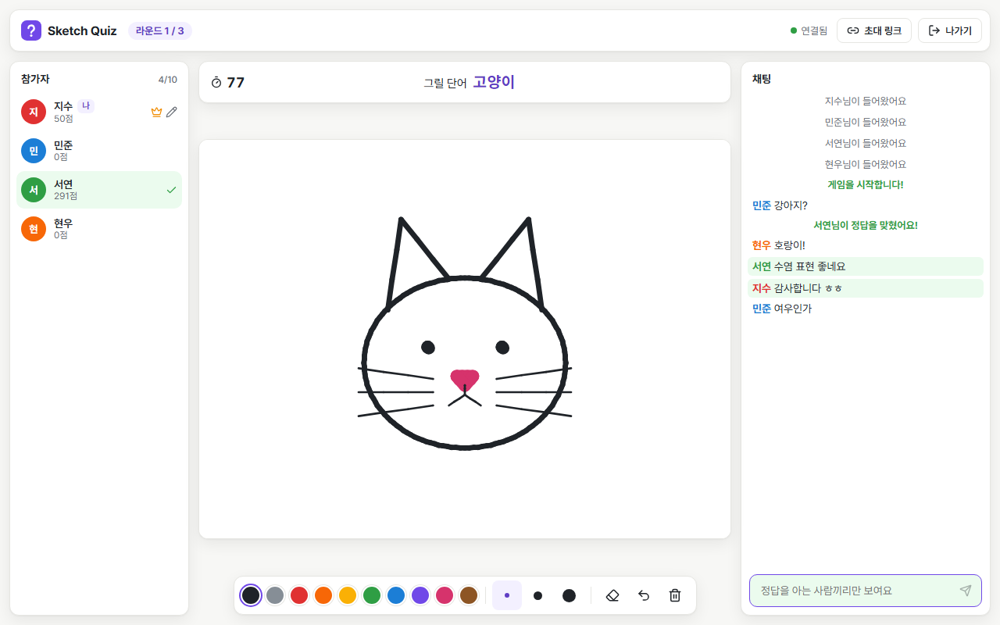
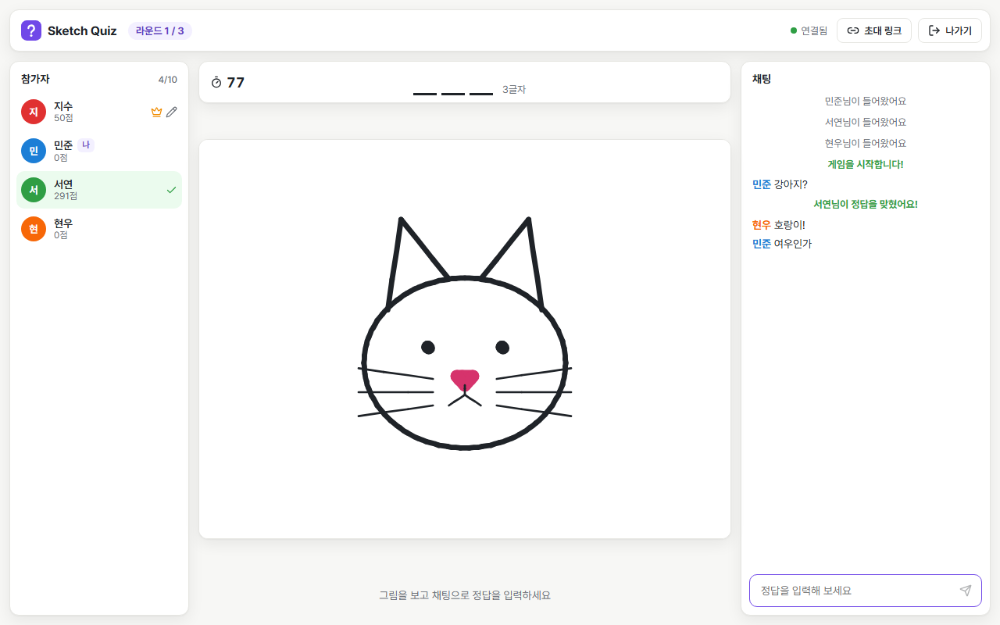
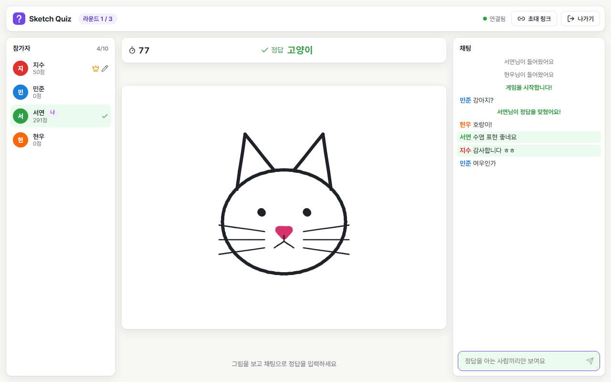
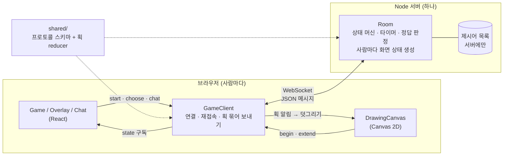

# Sketch Quiz

링크 하나로 친구들과 바로 하는 실시간 그림 맞히기 게임입니다(캐치마인드 같은 게임).
WebSocket 위에 게임 프로토콜을 직접 설계해서, **같은 방에 있어도 사람마다 다른 것을 보게 하고**, 게임 진행은 **서버의 시계**가 정하게 만들었습니다.

> 앞서 만든 [collab-whiteboard](https://github.com/Jeonghyeock/collab-whiteboard)가 "모두가 같은 그림을 보게 하는 문제(정확성)"였다면,
> 이 프로젝트는 "사람마다 다른 것을 보여 주고, 서버가 시간에 따라 게임을 진행하는 문제(공정성과 실시간성)"입니다.

> Claude Code와 함께 만들었습니다.

같은 순간, 세 사람의 화면입니다.

| 그리는 사람 — 제시어가 보임 | 맞히는 사람 — 글자 수 힌트만 보임 | 이미 맞힌 사람 — 정답자끼리 채팅 |
| --- | --- | --- |
|  |  |  |

맞히는 사람(가운데)의 채팅에는 초록색 줄(정답을 아는 사람끼리의 대화)이 없습니다. 화면에서 숨긴 것이 아니라 **서버가 아예 보내지 않습니다.**

## 기능

- **게임 진행**: 대기실 → 단어 고르기(3개 중 1개) → 그리기 → 턴 결과 → 다음 사람, 정해진 라운드를 돌면 최종 순위
- **사람마다 다른 화면**: 제시어는 그리는 사람과 맞힌 사람에게만, 나머지는 시간에 따라 열리는 힌트(글자 수 → 초성 → 첫 글자)
- **정답 판정은 서버가**: 공백을 무시하고 정확히 같을 때만 정답, 정답 문장은 채팅으로 돌지 않음, 빨리 맞힐수록 높은 점수
- **실시간 그림**: 그리는 즉시 모두에게 보임, 색 10가지·굵기 3단계·지우개·실행 취소(`Ctrl+Z`)·모두 지우기
- **끊겨도 이어서**: 새로고침하거나 연결이 끊겨도 20초 안에 돌아오면 같은 자리·점수·그림으로 복귀
- **늦게 와도 바로**: 게임 중간에 들어오면 지금까지의 그림을 한 번에 받고, 다음 라운드부터 그릴 차례가 옴
- **남용 방지**: 메시지 스키마 검증, 연결당 메시지 폭주 차단, 채팅 도배 제한
- **기타**: 방장 위임, 초대 링크 복사, 모바일 레이아웃

## 게임 규칙

| 항목 | 값 |
| --- | --- |
| 인원 | 2~10명. 먼저 들어온 사람이 방장이고, 들어온 순서대로 그린다 |
| 라운드 | 방장이 2·3·5판 중 선택 (기본 3판). 한 라운드에 모두 한 번씩 그린다 |
| 그리는 시간 | 방장이 60·80·100초 중 선택 (기본 80초) |
| 단어 고르기 | 15초. 시간이 지나면 서버가 대신 고른다 |
| 힌트 | 그리기 시간의 50%에 초성, 75%에 첫 글자 공개 |
| 점수 | 맞힌 사람 `100 + 200 × 남은 시간 비율`(100~300점), 그린 사람은 맞힌 사람 한 명당 50점 |
| 턴 종료 | 시간 종료, 접속한 사람이 모두 맞힘, 그리는 사람이 나감 |
| 재접속 유예 | 20초. 지나면 퇴장 처리되고, 그리는 사람이었다면 턴이 끝난다 |

## 실행

Node.js 24 이상이 필요합니다(서버의 TypeScript를 빌드 없이 실행하기 위해 Node의 타입 제거 기능을 씁니다).

```bash
npm install

# 개발: http://localhost:5174 (서버는 3100번 포트)
npm run dev

# 프로덕션: 빌드 후 서버 하나가 화면과 WebSocket을 모두 제공 → http://localhost:3100
npm run build
npm start
```

혼자 확인할 때는 브라우저 창을 두 개(또는 일반 창 + 시크릿 창) 열면 됩니다. 탭마다 다른 참가자가 됩니다.
포트는 collab-whiteboard(3000/5173)와 겹치지 않게 잡아서 둘을 함께 띄울 수 있습니다.

| 환경 변수 | 기본값 | 설명 |
| --- | --- | --- |
| `PORT` | `3100` | 서버 포트 |
| `HOST` | (모든 주소) | 서버가 받을 주소 |

```bash
npm test            # 단위 + 통합 테스트 (Vitest)
npm run test:e2e    # 브라우저 E2E (Playwright, 처음에는 npx playwright install chromium)
npm run typecheck
```

Docker:

```bash
docker build -t sketch-quiz .
docker run -p 3100:3100 sketch-quiz
```

## 구조



```
shared/          서버와 클라이언트가 함께 쓰는 코드
  protocol.ts    메시지 스키마(zod)와 타입
  drawing.ts     획 reducer(applyDrawOp)와 한도 검사(acceptsDrawOp)
  limits.ts      인원·길이·좌표 한도, 캔버스 가상 해상도
server/
  room.ts        방 하나의 게임: 상태 머신, 타이머, 정답 판정, 점수, 재접속 유예, 사람마다 다른 화면 상태
  app.ts         HTTP/WebSocket 서버, 메시지 검증, 연결당 속도 제한, 죽은 연결 정리
  hint.ts        정답 비교(normalizeAnswer), 힌트(글자 수 → 초성 → 첫 글자)
  words.ts       제시어 목록 (브라우저 번들에 들어가지 않게 서버에만 둔다)
  rateLimit.ts   토큰 버킷
client/src/
  game/          GameClient(연결·재접속·획 전송), 캔버스, 채팅, 참가자, 안내 화면
e2e/             두 브라우저로 게임 한 턴을 검증하는 Playwright 테스트
docs/            프로토콜 설계 문서
```

## 설계 요약

자세한 내용과 상태·시퀀스 다이어그램은 [docs/protocol.md](docs/protocol.md)에 있습니다.

1. **서버가 진행합니다.** 단계 전환, 타이머, 힌트 공개, 정답 판정, 점수를 모두 서버가 정합니다. 클라이언트 타이머가 0이 돼도 클라이언트는 아무것도 하지 않고 서버를 기다립니다.
2. **사람마다 다른 상태를 보냅니다.** 상태가 바뀔 때마다 서버가 받는 사람별로 화면 상태를 만들어 보냅니다(`viewFor`). 제시어는 그리는 사람과 맞힌 사람의 상태에만 담깁니다.
3. **정답을 아는 사람의 채팅은 그 사람들끼리만.** 그리는 사람과 맞힌 사람의 채팅을 나머지에게는 아예 보내지 않아 정답이 새지 않습니다.
4. **작고 사람마다 다른 것은 스냅샷, 크고 모두에게 같은 것은 증분.** 게임 상태(1~2KB)는 통째로, 그림은 op(`begin`/`extend`/`undo`/`clear`)로 보냅니다.
5. **그림은 40ms마다 묶어서.** 같은 획에 이어지는 점은 하나로 합치고, 좌표는 가상 해상도(1000×750)의 정수로 보냅니다. 받는 쪽은 새로 생긴 부분만 덧그립니다.
6. **시간은 남은 ms로.** 마감 시각 대신 남은 시간을 보내 서버와 브라우저의 시계가 달라도 타이머가 맞습니다.
7. **끊김 ≠ 퇴장.** 연결이 끊기면 20초 동안 자리를 잡아 두고, 비밀 토큰으로 돌아오면 같은 자리로 복귀합니다. 다른 사람에게는 공개 id만 보입니다.
8. **연결을 끊는 것은 정상 클라이언트라면 보내지 않을 메시지에만.** 단계가 막 바뀌는 순간에 도착한 메시지는 조용히 버립니다.

### 왜 화이트보드와 다른 동기화 방식을 썼나

화이트보드는 상태가 모두에게 같아서 변경 로그를 순번(seq)으로 동기화했습니다. 이 게임은 같은 로그를 모두에게 보내면 로그 안에서 정답을 찾을 수 있으므로, 어차피 서버가 사람마다 걸러야 합니다. 상태가 작으니 바뀔 때마다 그 사람용 전체 상태를 보내는 편이 단순하고, 재접속도 `welcome` 하나로 끝납니다. 근거는 [설계 문서](docs/protocol.md#10-왜-이렇게-만들었나)에 정리했습니다.

## 테스트

| 종류 | 대상 | 내용 |
| --- | --- | --- |
| 단위 | `server/room.ts` (가짜 시계) | **정답·후보 단어·남의 토큰이 못 맞힌 사람의 어떤 메시지에도 없음**, 후보는 그리는 사람에게만, 자동 선택, 힌트 단계, 점수, 정답자 채팅 분리, 모두 맞히면 조기 종료, 라운드 진행과 중간 참가자 차례, 재접속 유예와 복귀, 재접속 대기 중인 사람의 차례 건너뛰기, 그리는 사람 퇴장, 인원 부족 시 대기실, 방장 위임, 같은 토큰 재접속, 방 가득 참, 채팅 속도 제한 |
| 단위 | `shared/drawing.ts` | 획 reducer, 지운 획에 늦게 온 점 무시, 한도 검사 |
| 단위 | `server/hint.ts`, `server/rateLimit.ts` | 정답 정규화(공백·대소문자·NFD), 초성 계산(된소리, 한글 범위 양 끝, 한글 아닌 글자), 토큰 버킷 |
| 통합 | 실제 서버 + `GameClient` 여러 개 | 그림 전달과 정답 처리, 새로고침 후 같은 자리·그림 복귀, 그리는 사람 재접속 후 획 id 이어 매기기, 긴 획 자동 분할, 다른 탭이 자리를 가져가면 재접속하지 않음 |
| 서버 | `server/app.ts` | 잘못된 메시지 차단, 메시지 폭주 차단, 경로 탐색 차단, SPA 경로 |
| E2E | 브라우저 2개 (Playwright) | 그림이 상대에게 보이고 맞히는 사람 화면에 정답이 없음, 정답 처리와 점수, 그리는 도중 새로고침, 실행 취소·모두 지우기, 나가기 |

통합 테스트는 브라우저 없이 Node에서 실제 WebSocket으로 서버에 붙습니다. `GameClient`가 브라우저 표준 `WebSocket`만 쓰기 때문에 같은 코드를 그대로 테스트할 수 있습니다.
가짜 시계는 소켓과 섞으면 다루기 어려워서, 시간 규칙은 소켓 없이 `Room` 단위 테스트에서 가짜 시계로, 소켓을 거치는 흐름은 통합 테스트에서 진짜 시계와 짧은 대기 시간으로 나눠 검증했습니다.

## 한계와 다음 단계

- **서버 한 대, 메모리에만 저장**: 서버가 재시작되면 진행 중인 게임이 사라집니다(클라이언트는 다시 붙어 빈 대기실로 들어갑니다). 방 상태를 Redis에 두고 서버 간 메시지를 pub/sub으로 주고받으면 수평 확장과 재시작 복구를 함께 해결할 수 있습니다 — 다음 단계로 계획하고 있습니다.
- **새로고침하면 채팅 기록이 사라짐**: 서버가 채팅 기록을 보관하지 않습니다. 보관하려면 "정답자끼리 채팅"을 받는 사람 기준으로 다시 걸러서 보내야 합니다.
- **그리는 사람의 연결이 조용히 끊기면 그 사이의 획을 잃을 수 있음**: 끊긴 것을 알아채면 그리기를 막지만, 와이파이가 조용히 끊긴 경우에는 하트비트가 알아챌 때까지(길게는 30초 정도) 그린 획이 서버에 닿지 않을 수 있습니다. 다시 붙으면 서버의 그림으로 덮어씁니다.
- **받는 쪽 그림이 40ms 단위로 끊겨 보일 수 있음**: 묶음을 받은 대로 그리기 때문입니다. 받은 점을 다음 묶음이 올 때까지 나눠 그리면 더 부드럽습니다.
- **정답은 정확히 일치만**: "거의 맞았어요" 같은 근접 판정(편집 거리)이 없고, 제시어 목록이 한국어 170여 개로 고정입니다.
- **인증 없음**: 방 링크(추측하기 어려운 10자리 id)를 아는 사람은 누구나 들어올 수 있고, 강퇴·관전 기능이 없습니다.
- 페인트 통(영역 채우기) 도구가 없습니다.

## 라이선스

MIT
