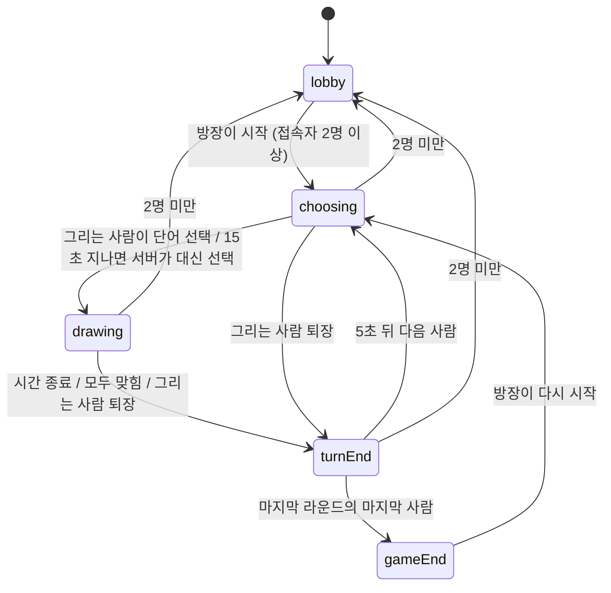
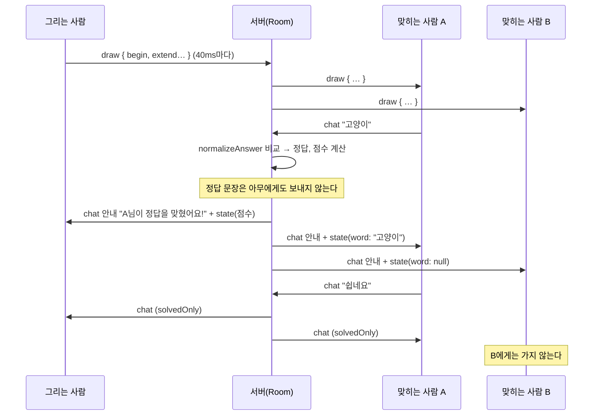
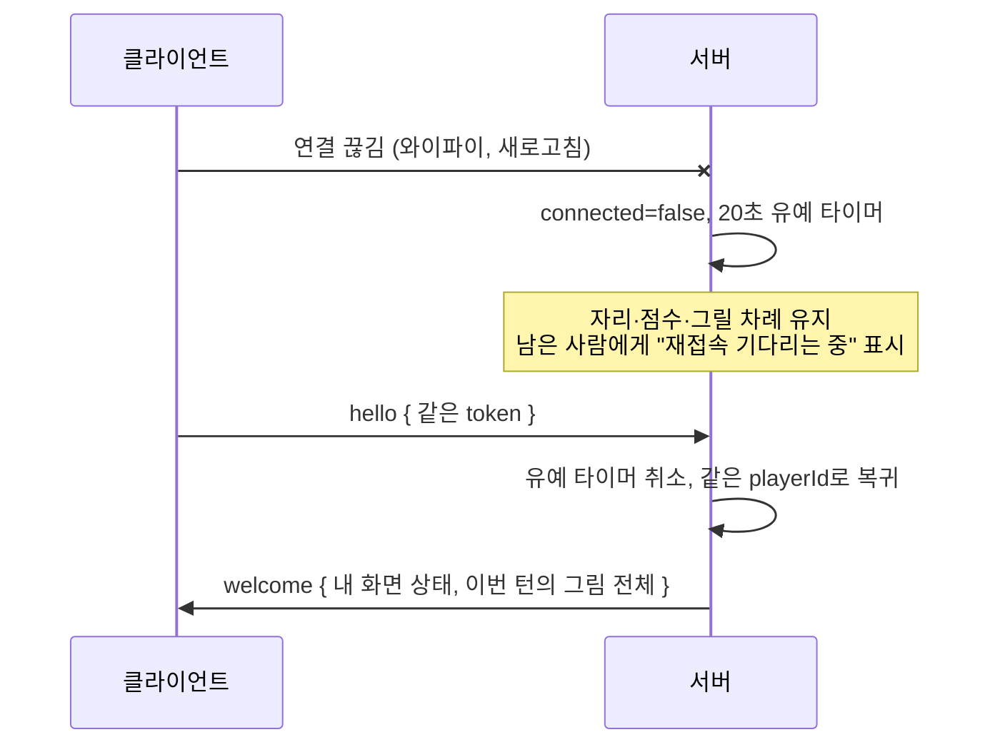

# 게임 프로토콜 설계

이 문서는 "같은 방에 있어도 사람마다 봐야 하는 것이 다르고, 게임은 서버의 시계에 따라 진행되며, 그림은 그리는 즉시 모두에게 보여야 한다"를 어떻게 풀었는지 설명합니다. 각 절에 해당 파일을 적어 두었습니다.

## 1. 한 문장 요약

**게임 진행(단계 전환, 타이머, 정답 판정, 점수)은 전부 서버가 정하고, 서버는 상태가 바뀔 때마다 사람마다 다르게 만든 화면 상태를 보낸다. 그림만 양이 많아 증분(op)으로 흘려보낸다.**

[collab-whiteboard](https://github.com/Jeonghyeock/collab-whiteboard)는 모두가 같은 상태로 수렴하는 것이 목표라 변경 로그(seq)를 동기화했습니다. 이 게임은 반대로 **모두가 같은 것을 보면 안 됩니다**(정답은 그리는 사람만 알아야 함). 그래서 동기화 방식도 다르게 골랐습니다(→ [10절](#10-왜-이렇게-만들었나)).

## 2. 게임 상태 머신 — `server/room.ts`



| 단계 | 끝나는 조건 | 기본값 |
| --- | --- | --- |
| `choosing` | 그리는 사람이 3개 후보 중 하나를 고르거나 시간 초과(서버가 무작위 선택) | 15초 |
| `drawing` | 시간 종료, 접속한 사람이 모두 맞힘, 그리는 사람이 나감 | 방장이 60·80·100초 중 선택 (기본 80초) |
| `turnEnd` | 정답과 이번 턴 점수를 보여 준 뒤 자동으로 다음 차례 | 5초 |

- **그리는 순서** = 방에 들어온 순서. 라운드마다 그 시점의 참가자 목록으로 순서를 새로 정하므로, 라운드 중간에 들어온 사람은 다음 라운드부터 그립니다. 차례가 왔을 때 재접속을 기다리는 중인 사람은 그 차례를 건너뜁니다(뽑아 봐야 아무도 그릴 수 없는 시간만 생기므로).
- **타이머는 서버에만** 있습니다. 단계를 바꿀 때 이전 단계의 타이머를 모두 지우므로(`setPhase`), "시간 종료"와 "모두 맞힘"이 거의 동시에 일어나도 턴이 두 번 끝나지 않습니다.
- 테스트는 vitest 가짜 시계로 시간을 움직입니다. Room은 전역 `setTimeout`/`Date.now`만 쓰고 모든 대기 시간을 옵션으로 받습니다.

## 3. 메시지 — `shared/protocol.ts`

| 방향 | 메시지 | 의미 |
| --- | --- | --- |
| C → S | `hello { roomId, token, name }` | 접속. `token`은 이 탭이 만든 비밀값(재접속용) |
| C → S | `start { settings }` | 게임 시작(방장만, 대기실 또는 게임 끝 화면에서) |
| C → S | `choose { index }` | 후보 단어 선택(그리는 사람만) |
| C → S | `draw { ops }` | 그림 변경 묶음(그리는 사람만, 그리기 단계에서만) |
| C → S | `chat { text }` | 채팅. 그리기 단계에서는 서버가 정답인지 먼저 확인한다 |
| C → S | `leave` | 나가기 버튼. 유예 시간 없이 바로 자리를 비운다 |
| C → S | `ping` | 연결 확인 |
| S → C | `welcome { playerId, state, strokes }` | 접속 응답. 내 공개 id, 내 화면 상태, 이번 턴의 그림 전체 |
| S → C | `state { state }` | 화면 상태가 바뀔 때마다. **받는 사람마다 내용이 다르다** |
| S → C | `draw { ops }` | 그림 변경. 그린 사람에게는 보내지 않는다 |
| S → C | `chat { entry }` | 채팅 또는 안내 문구 |
| S → C | `pong` | ping 응답 |

`state`에는 참가자 목록(점수, 접속 여부, 이번 턴에 맞혔는지), 방장, 설정, 라운드, 단계별 정보가 들어갑니다. 10명 기준 1~2KB라 바뀔 때마다 통째로 보내도 부담이 없습니다.

## 4. 사람마다 다른 화면

| | 그리는 사람 | 맞힌 사람 | 아직 못 맞힌 사람 |
| --- | --- | --- | --- |
| 단어 후보 3개 (`choosing`) | 보임 | – | 안 보임 (`choices: null`) |
| 제시어 (`drawing`) | 보임 | 보임 | 안 보임 (`word: null`), 힌트만 |
| 정답을 아는 사람끼리의 채팅 | 보임 | 보임 | **받지도 않음** |
| 제시어 (`turnEnd` 이후) | 보임 | 보임 | 보임 |

`viewFor(viewer)`가 받는 사람마다 상태를 따로 만듭니다. 규칙은 이렇습니다.

1. **정답 판정은 서버만 합니다.** 클라이언트는 제시어를 모르므로 판정할 수도 없습니다. 공백·대소문자를 무시하고 정확히 같을 때만 정답입니다(`server/hint.ts`의 `normalizeAnswer`).
2. **정답은 채팅으로 돌지 않습니다.** 정답을 입력하면 그 문장은 아무에게도 전달되지 않고, 대신 "OO님이 정답을 맞혔어요!" 안내만 갑니다. `고양이?`, `고양이ㅋㅋ`처럼 정답이 들어 있지만 정답은 아닌 말은 오답이고, 보낸 사람에게만 돌려줍니다. 보낸 사람에게 따로 알리지 않는 것은, 알리면 단어 여러 개를 넣어 보내 보며 어느 말에 정답이 있는지 알아낼 수 있기 때문입니다.
3. **정답을 아는 사람의 채팅은 정답을 아는 사람끼리만 봅니다.** 그리는 사람과 이미 맞힌 사람의 채팅을 모두에게 보내면 정답이나 결정적인 힌트가 새기 때문입니다. 클라이언트에서 숨기는 것이 아니라 **서버가 아예 보내지 않습니다.**
4. **제시어 목록은 서버에만 있습니다**(`server/words.ts`). `client/`에서 import하면 Vite가 목록 전체를 번들에 넣으므로 공용 폴더(`shared/`)에도 두지 않았습니다.
5. **공개 id와 비밀 토큰을 나눴습니다.** 참가자 목록에는 서버가 매긴 `playerId`만 나가고, 재접속에 쓰는 `token`은 어떤 메시지에도 담기지 않습니다. 토큰이 목록에 보였다면 다른 사람이 그 토큰으로 접속해 남의 자리(점수, 그릴 차례)를 가로챌 수 있습니다.

`server/room.test.ts`의 "정답을 맞히기 전에는 정답·후보 단어·남의 토큰이 어떤 메시지에도 담기지 않는다" 테스트가 이 규칙을 지킵니다. 아직 못 맞힌 사람이 받은 **모든 메시지를 이어 붙인 문자열**에 후보 단어 세 개와 다른 사람의 토큰이 없는지 확인합니다(힌트가 모두 공개되고, 다른 사람이 정답이 들어 있는 오답을 보내고 맞히고, 정답자끼리 정답을 언급한 뒤에도).

### 힌트

그리기 시간의 50%, 75%가 지나면 서버가 힌트를 한 단계씩 열고 `state`를 다시 보냅니다.

| 단계 | 보이는 것 | 예 (`고양이`) |
| --- | --- | --- |
| 0 | 글자 수 | `○○○` |
| 1 | 초성 | `ㄱㅇㅇ` |
| 2 | 첫 글자 + 초성 | `고ㅇㅇ` |

초성은 `(코드 - 0xAC00) / 588`로 구합니다(중성 21 × 종성 28 = 588). 한글이 아닌 글자는 초성이 없으므로 1단계에서도 계속 가리고, 공백은 항상 보여 줍니다.

### 점수

- 맞힌 사람: `100 + 200 × (남은 시간 / 전체 시간)` → 바로 맞히면 300점, 끝나기 직전이면 100점
- 그린 사람: 맞힌 사람 한 명당 50점 (잘 그려야 점수를 받는다)

## 5. 그림 스트리밍 — `shared/drawing.ts`, `client/src/game/GameClient.ts`

```ts
{ kind: 'begin', id, color, width, points }   // 새 획
{ kind: 'extend', id, points }                // 마지막 획에 점 덧붙이기
{ kind: 'undo' }                              // 마지막 획 지우기
{ kind: 'clear' }                             // 모두 지우기
```

- **좌표는 가상 해상도(1000×750) 기준 정수**입니다. 화면 크기가 달라도 같은 그림이 되고, 소수가 없어 메시지가 짧습니다. 지우개는 배경색(흰색)으로 그리는 획입니다.
- **같은 reducer를 서버와 클라이언트가 함께 씁니다**(`applyDrawOp`). 초당 수십 번 불리므로 새 배열을 만들지 않고 제자리에서 고칩니다.
- **`extend`는 마지막 획의 id가 같을 때만 붙습니다.** 실행 취소로 지운 획에 늦게 도착한 점이 바로 앞 획에 붙지 않게 하기 위해서입니다.
- **보내는 양 줄이기.** 그리는 사람은 40ms마다 모아 보내고, 같은 획에 이어지는 점은 보내기 전에 op 하나로 합칩니다. 2px보다 가까운 점은 버리고, 대신 `getCoalescedEvents()`로 브라우저가 묶어 둔 점까지 꺼내 써서 빠르게 그어도 선이 부드럽습니다.
- **그린 사람에게는 되돌려 보내지 않습니다.** 그린 사람은 이미 자기 화면에 그렸습니다. 그리는 사람이 한 명뿐이라 순서 충돌이 없으므로, 화이트보드처럼 "확정 상태 + 대기 변경"을 따로 들고 있을 필요가 없습니다.
- **한도.** 획 하나 4000좌표(점 2000개), 한 턴 2000획·20만 좌표. 서버와 클라이언트가 같은 함수(`acceptsDrawOp`)로 검사하므로 "그린 사람 화면에는 있는데 서버가 버린 획"이 생기지 않습니다. 획 하나가 한도에 닿으면 클라이언트가 마지막 점에서 이어지는 새 획으로 나눕니다(보기에는 한 획).
- **늦게 들어온 사람.** 서버는 이번 턴의 그림을 들고 있다가 `welcome`에 담아 한 번에 보냅니다. 새 턴이 시작되면 서버가 모두에게 `clear`를 보내고 자기 사본도 비웁니다.

캔버스(`DrawingCanvas.tsx`)는 그림을 React 상태에 넣지 않습니다. `GameClient.strokes`를 직접 읽고, op가 하나 적용될 때마다 알림을 받아 **새로 생긴 부분만 덧그립니다.** `undo`·`clear`·창 크기 변경 때만 전체를 다시 그립니다.

## 6. 정답 맞히기 흐름



## 7. 시간

- **남은 시간을 ms로 보냅니다**(`remainingMs`). 마감 시각(절대 시각)을 보내면 서버와 브라우저의 시계가 어긋난 만큼 타이머가 틀립니다. 클라이언트는 받은 순간 `Date.now() + remainingMs`로 자기 시계 기준 마감 시각을 만들고, 화면에는 0.25초마다 남은 초를 다시 계산해 보여 줍니다. 네트워크 지연만큼(수십 ms) 늦게 보일 수 있지만 판정은 서버 시계로 하므로 공정합니다.
- 힌트 공개와 시간 종료도 서버 타이머가 정합니다. 클라이언트 타이머가 0이 돼도 클라이언트는 아무것도 하지 않고 서버의 `state`를 기다립니다.

## 8. 끊김과 재접속



- **토큰은 탭마다 따로**(sessionStorage) 둡니다. 새로고침하면 같은 자리로 돌아오고, 새 탭으로 열면 새 참가자가 됩니다.
- **끊김과 퇴장을 구분합니다.** 소켓이 닫히면 바로 내보내지 않고 20초 기다립니다. 그 사이 그리는 사람이 돌아오면 이어서 그리고, 시간이 지나면 내보내며 그리는 사람이었다면 턴을 끝냅니다. "나가기" 버튼은 `leave`를 보내 바로 자리를 비웁니다.
- **끊긴 사람은 "모두 맞힘" 계산에서 뺍니다.** 끊긴 사람 때문에 나머지가 시간을 다 기다리지 않게 하기 위해서입니다. 다만 끊긴 순간에는 확인하지 않고, 누군가 맞혔을 때와 유예 시간이 지나 내보낼 때 확인합니다. 아직 못 맞힌 마지막 사람이 새로고침했을 뿐인데 턴이 끝나면 안 되기 때문입니다.
- **같은 토큰으로 새 연결이 오면 이전 연결을 닫습니다**(4000). 받은 쪽 클라이언트는 다시 연결하지 않습니다. 브라우저의 "탭 복제"는 sessionStorage까지 복사하므로, 다시 연결하게 두면 두 탭이 서로 자리를 뺏으며 끝없이 재접속합니다.
- 재접속은 지수 백오프 + 지터, 죽은 연결 감지는 앱 레벨 ping(브라우저)과 WebSocket ping(서버)으로 합니다. 이 부분은 화이트보드와 같습니다.
- 그리는 사람이 끊긴 동안 그린 획은 버립니다. 다시 붙으면 서버가 가진 그림으로 덮어쓰고, 획 id는 서버 그림의 마지막 id 다음부터 이어 매깁니다.

## 9. 남용 방지 — `server/app.ts`, `server/rateLimit.ts`

| 상황 | 처리 |
| --- | --- |
| JSON이 아님 / 스키마 위반 / 바이너리 | 연결 종료 (1007 / 1008 / 1003) |
| 메시지 크기 초과 (64KB) | 연결 종료 (1009) |
| 접속 후 10초 안에 `hello` 없음 | 연결 종료 (1008) |
| 메시지 폭주 (연결당 토큰 버킷: 순간 100개, 초당 50개) | 연결 종료 (4008), 클라이언트는 잠시 뒤 재접속 |
| 채팅 도배 (사람당 토큰 버킷: 순간 5개, 초당 1개) | 그 메시지만 버리고 보낸 사람에게만 안내 |
| 방이 가득 참 (10명) | 연결 종료 (4003), 클라이언트는 재접속하지 않음 |
| 단계가 막 바뀌는 순간의 메시지 (시간 종료 직후의 획, 자동 선택 뒤의 `choose`, 방장이 아닌 사람의 `start`) | **조용히 버림** |

마지막 줄이 중요합니다. 정상적인 클라이언트도 네트워크 지연 때문에 "방금 끝난 단계"의 메시지를 보낼 수 있습니다. 이런 메시지에 연결을 끊으면 멀쩡한 사용자가 튕기므로, 연결을 끊는 것은 **정상 클라이언트라면 절대 보내지 않을 메시지**(스키마 위반, 폭주)로 한정했습니다.

## 10. 왜 이렇게 만들었나

### 왜 화이트보드처럼 변경 로그(seq)를 동기화하지 않았나

화이트보드의 상태는 모두에게 같고 커서 몇 MB가 될 수 있어, 변경분만 보내고 순번으로 빠진 것을 찾는 방식이 맞았습니다. 이 게임의 상태는 **작고(1~2KB) 사람마다 다릅니다.** 같은 변경 로그를 모두에게 보내면 클라이언트가 받은 로그에서 정답을 찾을 수 있으므로, 결국 서버가 사람마다 걸러야 합니다. 그럴 바에는 바뀔 때마다 그 사람용 전체 상태를 보내는 편이 단순하고 틀릴 여지가 없습니다. 재접속도 `welcome` 하나로 끝납니다.

반면 그림은 양이 많고 모두에게 같으므로 증분(op)으로 흘려보냅니다. **"작고 사람마다 다른 것"은 상태 스냅샷, "크고 모두에게 같은 것"은 증분**으로 나눈 것이 이 프로토콜의 핵심입니다.

### 왜 Socket.IO를 쓰지 않았나

방(room), 재접속, 연결 확인을 직접 만들어 보는 것이 목적이었습니다. 이 프로젝트에서는 특히 "같은 토큰으로 들어오면 이전 연결 닫기", "끊김과 퇴장 구분", "다시 연결하면 안 되는 종료 코드" 같은 게임 규칙이 연결 관리와 맞물려 있어, 직접 다루는 편이 설명하기도 쉬웠습니다.

### 왜 SVG가 아니라 Canvas인가

화이트보드의 도형은 하나하나 선택하고 옮겨야 해서 DOM 노드(SVG)가 편했습니다. 이 게임의 그림은 점 수천 개짜리 자유 곡선이고, 그린 뒤에 고칠 일이 없습니다(실행 취소는 마지막 획 통째로). 그래서 Canvas에 덧그리기만 하고, 원본 데이터는 `strokes` 배열로 따로 들고 있다가 필요할 때만 전체를 다시 그립니다.

### 왜 저장하지 않나

게임은 한 판 하고 끝나는 데이터라 서버 메모리에만 둡니다. 대가로 서버가 재시작되면 진행 중인 게임이 사라집니다(클라이언트는 자동으로 다시 붙지만 빈 대기실로 들어갑니다). 방 상태를 바깥(Redis 등)에 두면 서버 재시작과 수평 확장을 함께 해결할 수 있는데, 이것이 다음 단계입니다.
